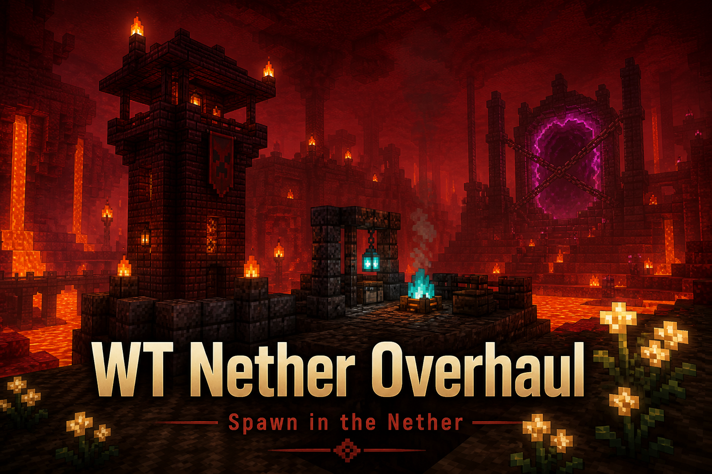

# WT Nether Overhaul



A NeoForge 1.21.1 replacement for the 1.12.2 **Nether Overload** mod. Built for the Dimension Survival remake: you wake in the Nether, the Overworld stays sealed until you find a Rift Key, and the Nether itself is taller, carved with ravines, and dotted with towers, hamlets and wither-ruin pits.

**Download:** [GitHub Releases](https://github.com/whotevatech/nether-overhaul/releases/latest) · Minecraft **1.21.1** · NeoForge **21.1.244+**

Use a **new world** after updating. Worldgen, camp layout and structure grids do not retrofit existing chunks.

## Requirements

- Minecraft 1.21.1
- Java 21
- NeoForge 21.1.244 or newer

## What it does

- **Nether spawn camp.** First join builds a blackstone-brick shelter with crimson posts, a lectern (the lore book), crafting, furnace, smoker, anvil, water cauldrons, a charged respawn anchor, a signed lodestone, a fenced mature wart and berry patch, and a starter chest (stone tools, golden pick, food, wool, flint, gravel, string). You also get the book, a camp compass, a Sealed Flask and 60s fire resistance.
- **Overworld lock.** Portals stay sealed until you use a Rift Key. Creative and operators bypass this by default. Locked portal spam is throttled.
- **Keep-inventory until unlock.** Deaths before the rift opens keep items and XP (config).
- **256-block Nether.** Floor, roof, pillars, lava sea and ravines. Vanilla nether biomes plus Ashen Swamp, Wither Ruins, Quartz Peaks, Ember Fields and Weeping Hollow. Water can be placed (this dimension is not ultra-warm) so cobble and potions are possible.
- **Structures.** Watchtowers, hamlets, wither-ruin pits, ghast nests, basalt forges, quartz shrines, obsidian wells, nether dungeons, ash pyres, rift altars, original-style blaze towers and fire towers. Fortresses and bastions can also generate in the new biomes. Pits, shrines and altars are where Rift Shards and Rift Keys show up.
- **Original Nether Overload extras.** Glowstone berries grow on soul sand, glow when eaten, and can shed glowstone dust. Quick soul sand is cracked with soul light and traps you like cobweb. Fire-immune nether creepers (they set fires), spiders and zombies spawn in the wastes. Wither trees and glowstone trees decorate ruins and quartz peaks.
- **Tools.** Rift Seeker (sneak to pick a structure, then it points and leaves soul flames), Recall Charm (return to camp), Sealed Flask (fill cauldrons / place water), Rift Shard (four around crying obsidian craft a Rift Key).
- **Pack ores.** Iron, copper, coal and redstone generate in netherrack. `#netheroverhaul:extra_nether_ores` optionally includes Mekanism, AE2, Immersive Engineering, Create, Thermal, Modern Industrialization, Mystical Agriculture, Occultism, Powah and others. Missing mods are skipped. Gravel smelts to sand; four soul soil crafts clay.
- **Vanilla injects.** Fortress / bastion chests and piglin barters can roll this mod's items.
- **Quest hook.** Dummy scoreboard `netheroverhaul_rift` is 1 after unlock (FTB Quests / KubeJS).

## Commands

```
/netheroverhaul where
/netheroverhaul unlock [player]
/netheroverhaul lock [player]
/netheroverhaul spawn
/netheroverhaul locate [tower|hamlet|pit|nest|forge|shrine|well|dungeon|ring|pyre|blaze|firetower|altar]
/netheroverhaul key
/netheroverhaul kit
```

`where` is usable by anyone. The rest require permission level 2.

## Config

Server config `netheroverhaul-server.toml` covers spawn, lock, keep-inventory, camp gifts, anchor charges, seeker range, recall and flask behaviour, structure spacing (including wells, dungeons, pyres, blaze towers, fire towers and altars) and extra-ore attempts.

Worldgen, camp layout and structure grids apply to **new worlds** only. Changing spacing does not move builds that already generated.

## Backup recipe

A Rift Key can also be crafted from a nether star, ghast tear, two eyes of ender and a blaze rod. Disable it with `allowRiftKeyCrafting`. Four rift shards around crying obsidian assemble one as well (`allowRiftShardAssembly`).

## Build

```bat
gradlew.bat build
```

The jar lands in `build/libs/netheroverhaul-neoforge-1.21.1-1.4.0.jar`.

## Licence

MIT — see [LICENSE](LICENSE).

Nether Overload was created by **MCJediYoda**. This is a from-scratch NeoForge remake, not a continuation of that CurseForge project.
